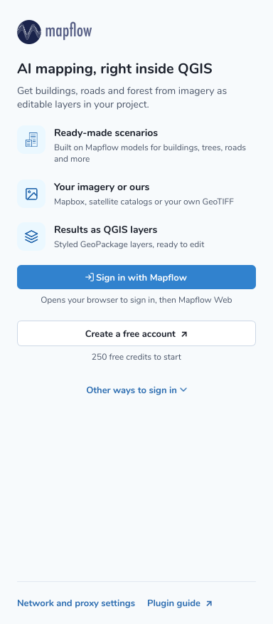
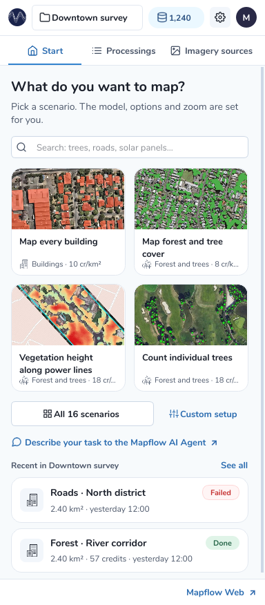
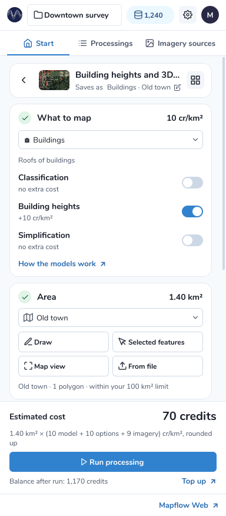
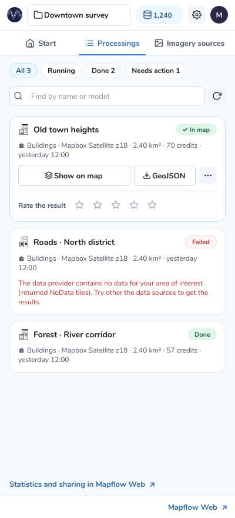

# Mapflow for QGIS

At [Geoalert](https://www.geoalert.io/en-US/) we use AI to extract real-world objects from satellite and
aerial imagery. With the [Mapflow](https://mapflow.ai/) plugin you choose what to map, where and from which
imagery, and the results come back as styled layers in your QGIS project: buildings (optionally with
height), forest (optionally with height), roads, fields, construction sites and more. See the
[models](https://docs.mapflow.ai/userguides/pipelines).

This repository holds **Mapflow Next** (`mapflow_next/`, version 4.0.0), a redesigned plugin for
**QGIS 3.22+ and QGIS 4**. Everything in it follows one flow: **model → area → imagery → processing →
results**. The previous plugin (3.x, `mapflow/`) is in the history up to tag `v3.6.3`.

| Sign in | Start | Run form | Processings |
|---|---|---|---|
|  |  |  |  |

More screens in [`docs/screens/`](docs/screens): imagery search, My imagery and its collection picker, the
projects window, the scenario gallery and dark mode. The end-to-end test writes them (`make screens`), so
they show the plugin as it is.

## Install

- **From a zip:** Plugins › Manage and Install Plugins › Install from ZIP, with the zip from `make zip`.
  The plugin is called **Mapflow Next** (folder `mapflow_next`), so it installs next to the 3.x
  Mapflow plugin instead of replacing it.
- **For development:** `make link` symlinks `mapflow_next/` into your QGIS profile, then reload the
  plugin with Plugin Reloader. The default path is the macOS one for QGIS 3; use `make link QGIS_MAJOR=4`
  for QGIS 4, or set `PLUGINS_DIR` on Linux or Windows.

The plugin adds a Mapflow toolbar, whose button opens the Mapflow dock on the right. The Plugins ›
Mapflow Next menu has the same button, Scenarios…, which opens the scenario gallery directly, and Check
for updates…. The update check asks your plugin repositories, through QGIS's own plugin installer, and
an update installs from the Plugin Manager's Upgradeable tab. A plugin installed from a ZIP isn't in any
repository, so the check points to the releases page instead. A Mapflow account is needed: [sign up](https://app.mapflow.ai). The user guide
for the 3.x plugin is [here](https://docs.mapflow.ai/api/qgis_mapflow).

## QGIS 3 and QGIS 4

One zip runs in QGIS 3.22 and later (Qt 5) and in QGIS 4 (Qt 6): `metadata.txt` sets
`qgisMinimumVersion=3.22` and `qgisMaximumVersion=4.99`. Every feature works in both.

To keep it that way, write code both Qt versions accept. `tests/test_core.py` and `tools/qt6_check.py`
check these rules:
- Import Qt only through `qgis.PyQt`, never from `PyQt5` or `PyQt6` directly.
- Use scoped enum names: `Qt.AlignmentFlag.AlignLeft`, `QSizePolicy.Policy.Expanding`,
  `Qgis.MessageLevel.Info`. Qt 6 rejects `Qt.AlignLeft`, and enum values read from an object
  (`action.NoRole`).
- Use `exec()`, not `exec_()`.
- Build menu items as `QAction`s, with `widgets.menu_action`.
- Read mouse positions through `widgets.event_pos`.
- Take geometry types from `qgis_bridge/compat.py`.
- `QSvgWidget` moved to `QtSvgWidgets` in Qt 6. `ui/icons.py` imports it from either place.

Run `tools/qt6_check.py --fix` to rewrite unscoped enum names automatically.

The tests run on both versions (see [Development](#development)). `tests/qt6_ui.py` also drives the
pages, the browser sign-in listener and the HTTP client on plain PyQt6, through a stand-in for QGIS 4's
`qgis.PyQt` (`tests/qt6_shim/`), for when QGIS 4 isn't at hand. From the Python console of any
installed QGIS, `tools/run_in_qgis.py` runs the end-to-end tests with that QGIS's own Python.

## How it works

```
mapflow_next/
  plugin.py          QGIS entry: the Mapflow toolbar, the plugin menu, the dock, wiring of the parts below
  controller.py      the flow: connects services (state) to pages (views) and to QGIS
  config.py          environments, URLs, timings
  settings.py        QgsSettings under mapflow_next/ (never credentials)
  core/              pure Python, no Qt: testable without QGIS
    models.py          API responses → Project, Model (workflow def), DataProvider, Processing, …
    draft.py           the run form as data: issues(), estimate(), payload()
    scenarios.py       scenario catalogue and scenario → model matching
    messages.py        readable texts for Mapflow error codes
    oauth.py           browser sign-in without Qt: PKCE, the redirect, tokens
  api/
    http.py            async HTTP over QgsNetworkAccessManager, error classification
    auth.py            credentials in the QGIS authentication database
    oauth.py           browser sign-in: the loopback listener and token requests
    client.py          the Mapflow endpoints the plugin uses
  services/          Qt objects with signals: session, processings, imagery, results
  qgis_bridge/       map-side code: area from layers, layers and styles, draw tool, QGIS 3/4 compat
  ui/                dock, pages, gallery, dialogs, theme (design tokens) and icons, built in code
  resources/         scenario data and pictures, result styles (QML), Nunito, brand icons
```

State lives in services. Pages only render it and emit what the user wants. `controller.py` connects
the two.

## What it keeps from the 3.x plugin

- **API:** the same endpoints and v2 processing payload (`processings/v2`, `processing/cost/v2`,
  `projects/{id}/processings/v2/page`, `catalog/meta`, `rasters/mosaic…`, `processings/{id}/result`).
- **Sign-in:** the same Mapflow sign-in client (`qgis`) and redirect address
  (`http://127.0.0.1:7070/qgis`). The `mapflow_env` QGIS variable picks the environment, as before.
- **Area rules** (spec 002_B):
  - The area is measured on the union of its parts, and each part is repaired first.
  - The plan limit is checked both on the total and on each polygon's bounding box.
  - A selection on the area's layer narrows the area to the selected polygons.
- **Results:**
  - Downloaded as GeoJSON, written to a GeoPackage, styled with the same QML styles, and added to the
    "Mapflow" group.
  - Vector tiles are an option. Their extent comes from the tilejson `bounds`, or else from the
    processing's area.
- **Error texts:** all 64 error-code descriptions.
- **3.6.x fixes:**
  - In-flight replies are held until they finish, and large downloads are streamed to disk.
  - Overlapping polygons are counted once.
  - Your rights in shared projects follow your account.

## What it does differently

- **Browser sign-in:** the plugin runs it itself instead of using QGIS's OAuth2 method, then sends the
  browser on to app.mapflow.ai.
  - It listens on 127.0.0.1 only and checks the answer with PKCE and a state value.
  - You stay signed in across QGIS restarts. The plugin never opens the browser on its own, and QGIS
    doesn't need a restart after the first sign-in.
- **Credentials:** the API token (a fallback) and the browser sign-in are kept in the QGIS
  authentication database, never in plain settings.
- **One flow instead of five tabs:** the tabs are Start, Processings and Imagery sources. Settings and
  the account move to the header.
- **Scenario gallery:** 16 ready-made setups built on Mapflow models. The processing name is generated
  from the model and the area, and the pencil next to it opens a dialog for a name and a description.
- **Projects window:** project tiles with their description, done and failed counts, the last update
  and whether they're shared.
  - Search by name on the server, and load more with "Show more".
  - Pin projects to the top.
  - Share a project, or open the team page, in Mapflow Web.
- **Zoom:** basemaps offer z17–z21, with the scenario's zoom preselected and marked ★.
- **My imagery:**
  - Collections show their image count, and a picker lets you use the whole collection or one image.
  - The imagery's extent becomes the area, and any other area is clipped to the imagery.
  - An area outside the imagery blocks Run, with a way back to the extent.
- **Imagery search:** the same Area drop-down as on Start, date and slider filters, and "Clear".
- **Processings:** pages of 30 with "Show more". Polling refreshes the shown window and leaves older
  pages in place.
- **Live cost:** a local estimate at once, then the figure from `/cost`.
- **Results:** they go to `Documents/Mapflow` unless you choose another folder. Finished results load
  automatically, which you can turn off. "Run again" restores a processing's settings and its area.
- **Theming:** follows the QGIS light or dark theme, with the Mapflow design tokens.

## Not carried over yet

- **Planned processings** (templates) and their AOI management.
- **Custom XYZ/TMS providers.**
- **Review workflow actions.** A processing that needs review links to Mapflow Web.
- **Project management:** creating, renaming and deleting projects happens in Mapflow Web.
- **Smaller features:** georeferenced previews of catalog images, the forced-upgrade dialog, and Segment
  Anything zoom options.
- **Translations:** strings are English only. The 3.x translations (es, pt, ru, zh) aren't wired.

## To verify against the real API

- **Live API:** the tests use a mock API shaped like the spec. Nothing has been run against the live
  Mapflow API yet.
- **Mapflow Web links:** they open the app's home page, because deep links to a project or processing
  need the real web routes. The team page address (`TEAM_URL` in `config.py`) is a guess.
- **Plugin version header:** requests send `x-plugin-version: 4.0.0`. Check the backend doesn't treat
  it specially.
- **Scenario → model matching:** scenarios find their model by keywords in the project's model names. A
  stable scenario id on the backend would make this exact.
- **Pinned projects:** pins are kept on this computer. The backend's starred projects could make them
  follow the account.
- **Browser sign-in:**
  - The `qgis` client has to accept PKCE.
  - The `offline_access` scope would keep a sign-in for weeks.
  - A "You're signed in to QGIS" page in Mapflow Web would be a better landing than the home page.

## Development

Tests and lint run in the official `qgis/qgis` Docker images, so only Docker is needed:

```
make test          # both of the two runs below (the gate before review)
make test-qgis3    # unit + end-to-end tests on QGIS 3 (qgis/qgis:release-3_28)
make test-qgis4    # the same on QGIS 4 (qgis/qgis:4.2), plus the Qt 6 code check
make test-core     # pure-Python tests only (28)
make lint          # the plugins.qgis.org checks: flake8, bandit, detect-secrets
make screens       # run the end-to-end flow and rewrite docs/screens/*.png
```

With QGIS or PyQt6 installed, there are local variants:

```
make test-local QGIS_PYTHON=/Applications/QGIS-LTR.app/Contents/MacOS/bin/python3
make test-qt6 QT6_PYTHON=…    # the pages, sign-in and HTTP client on PyQt6 (41 checks)
make check-qt6 QT6_PYTHON=…   # Qt enum names and calls that only Qt 5 accepts
```

**The end-to-end test** (`tests/e2e_flow.py`, 166 checks) runs a real offscreen QGIS against a mock
Mapflow API and sign-in server (`tests/mock_server.py`).
- **Request checks:** the mock rejects request bodies the real API rejects, such as `myImagery` with both
  `mosaicId` and `imageIds`.
- **Sign-in:** a simulated browser signs in. The test then checks that the session renews, survives a
  restart, can be cancelled and is forgotten on sign-out.
- **The flow:** from there it covers scenarios and the run form, cost and the run itself, and results on
  the map. It also covers imagery search, My imagery, the projects window, processings paging and
  renaming, "Run again", the account menu, unload and dark mode.
- **Isolation:** each run gets its own QGIS settings and authentication database in a temporary folder.
- **Real clicks:** the test clicks the real buttons wherever a bug hid behind a click. For example,
  toggling an option must leave the form's scroll position alone.

CI (`.github/workflows/tests.yml`) runs `test-qgis3`, `test-qgis4` and `lint` on every push to `dev` and
`master` and on pull requests. Releases go through `qgis-plugin-ci` (`.qgis-plugin-ci` points at
`mapflow_next`).

## Contributing

See [CONTRIBUTING.md](CONTRIBUTING.md). Bugs and suggestions are welcome in
[Issues](https://github.com/Geoalert/mapflow-qgis/issues).

## License

This software is released under the [GNU General Public License](mapflow_next/LICENSE), version 2 or any
later version. You can inspect and modify the source code, and you always have access to it under the
same terms as QGIS: free of cost and free to modify.
