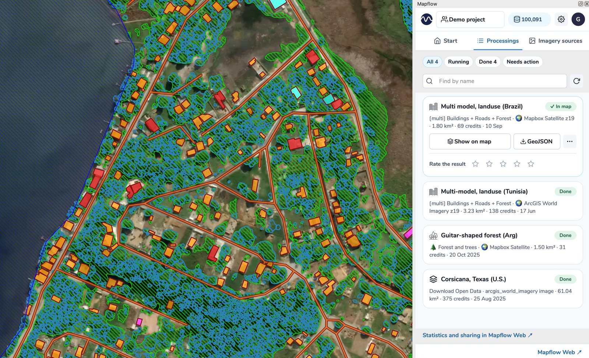
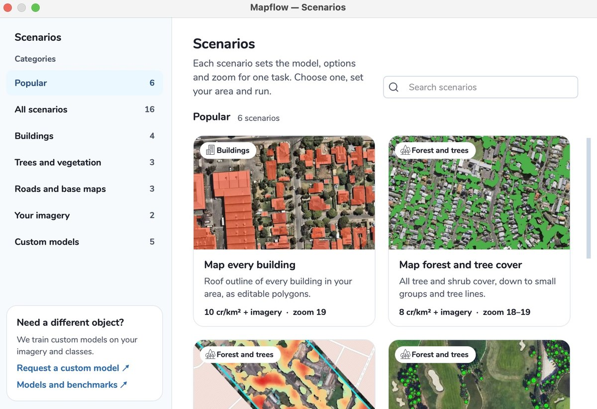
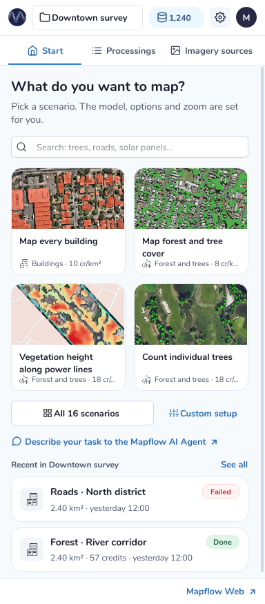
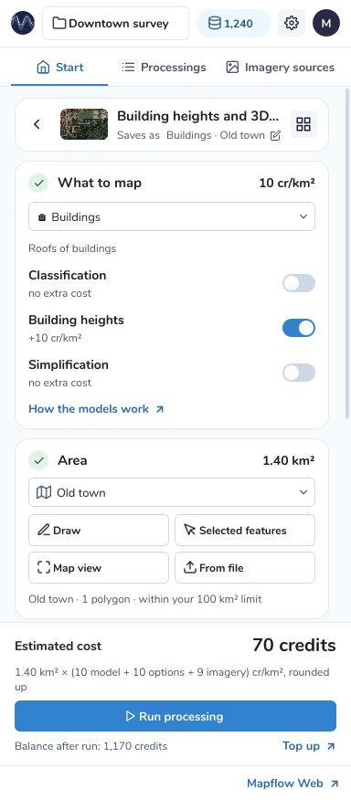
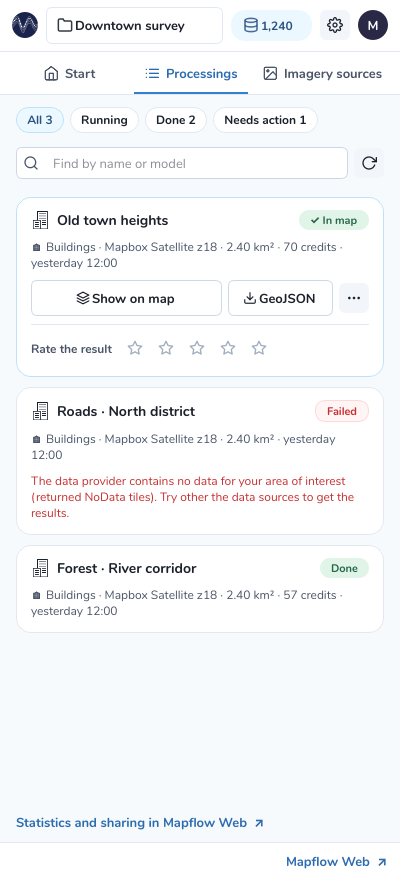

# Mapflow for QGIS

Map buildings, roads, forest and more from satellite, aerial or drone imagery, without leaving QGIS.
[Mapflow](https://mapflow.ai/) by [Geoalert](https://www.geoalert.io/en-US/) runs AI models on the imagery you
choose, and the results come back as styled layers in your project, ready to edit, measure and share.

This is **Mapflow Next** (4.0), a redesign of the Mapflow plugin for **QGIS 3.28 and later, and QGIS 4**.

## What you can do

- **Start from a scenario.** Pick a ready-made task (map every building, forest and tree cover, roads,
  building heights and more) and the plugin sets the model, its options and the zoom for you. Or choose a model
  yourself.
- **Set the area your way.** Use a polygon layer, selected features, a quick drawing or the current map view.
- **Use the imagery you need.** Global basemaps such as Mapbox and ArcGIS, fresh satellite images from the
  catalog, your own GeoTIFFs (drone, aerial or satellite), or an XYZ tile layer already in your project.
- **Know the cost before you run.** The price in credits updates as you change the area, the imagery and the
  options.
- **Get results as layers.** Finished processings load into the "Mapflow" group with their styles. You can
  also save them as GeoJSON.
- **Keep track of your work.** Follow progress, find past processings, run one again with the same settings,
  and switch between projects, including your team's.

## Get started

1. **Install.** In QGIS, open Plugins › Manage and Install Plugins…, search for **Mapflow Next** and install
   it. While 4.0 is experimental, turn on *Show also experimental plugins* in the Settings tab first. You
   can also download the zip from [Releases](https://github.com/Geoalert/mapflow-qgis/releases) and use
   *Install from ZIP*.
2. **Sign in.** Click the Mapflow button on the toolbar and sign in with your Mapflow account in the browser.
   No account yet? [Sign up](https://app.mapflow.ai).
3. **Run.** On Start, pick a scenario, set the area and the imagery, check the cost and press Run.
4. **Look at the results.** When the processing is done, its layers appear on the map.

| Start | The run form | Processings |
|---|---|---|
|  |  |  |

## The plugin or Mapflow Web?

Both use the same account, projects and credits, so you can start in one and continue in the other. Choose by
what you're doing.

**Use the plugin when the map is where the work happens.**

- *You're updating a city map and need the buildings of one new district.* Draw the district or use a layer
  you already have, run, and the buildings land on your map next to your other data, already styled.
- *A drone survey just came in as GeoTIFFs.* Right-click the layer › Use as imagery in Mapflow. It is
  uploaded to your imagery in Mapflow and chosen for the run as soon as it's ready.
- *Your team works from its own tile service.* An XYZ layer in your QGIS project can be the imagery, with
  nothing to set up in Mapflow, as long as Mapflow's servers can reach its address.
- *You want the latest satellite image of a site.* Search the catalog, compare the footprints and dates on
  your map, and run on the image that covers your area best.
- *You're checking or editing results.* They are ordinary QGIS layers, so you can edit, measure, join and
  export them like any other.

**Use [Mapflow Web](https://app.mapflow.ai) when the work is about managing, sharing or scale.**

- *Your area is a whole region, hundreds of square kilometres.* Mapflow Web runs the imagery search in the
  background and lets you keep working.
- *You need to watch an area over time,* for example for new construction every month. Planned searches live
  in Mapflow Web; the plugin shows them and opens them there.
- *Someone without QGIS needs to see the results,* such as a client or a manager. Share the project or the
  results from Mapflow Web.
- *Results are reviewed before they are accepted.* The review step is in Mapflow Web; the plugin marks the
  processings that need it.
- *You're managing your team, credits or API tokens,* or organising a large imagery library. Those pages are
  in Mapflow Web, and the plugin links to each one where you need it.

## Coming from the 3.x plugin?

- Mapflow Next installs **next to** the 3.x plugin, as a separate plugin, so you can try it without losing
  anything.
- **Sign in again**, and set your output folder again if you changed it. Settings aren't carried over.
- Sharing projects, reviewing results, topping up and API tokens are now in Mapflow Web, one click away from
  the plugin.
- The plugin is in English for now. Spanish, Portuguese, Russian and Chinese are planned for 4.1.

## Questions

**Where do the results go?** To `Documents/Mapflow`, unless you choose another folder in the settings (the
gear icon). Finished results load automatically; you can turn that off.

**What does a processing cost?** The run form shows the price before you run: the model's price per km² plus
the imagery's, for the area that is processed. See [pricing](https://mapflow.ai/pricing) and your balance in
the panel's header.

**macOS asks for my Keychain password.** Mapflow keeps your sign-in encrypted in QGIS's authentication
database. The first time you open Mapflow in a QGIS session, QGIS unlocks it with its master password,
which macOS keeps in the Keychain. Choose *Always Allow* in that dialog and it won't ask again.

**Something went wrong.** Report it in [Issues](https://github.com/Geoalert/mapflow-qgis/issues) or write to
[help@geoalert.io](mailto:help@geoalert.io). The [Mapflow documentation](https://docs.mapflow.ai) describes the
[models](https://docs.mapflow.ai/userguides/pipelines) and the imagery in detail.

## For developers

How the plugin is built and tested, its QGIS 3 and 4 rules, and what 4.0 keeps from 3.x, feature by feature,
are in [docs/DEVELOPMENT.md](docs/DEVELOPMENT.md). See also [CONTRIBUTING.md](CONTRIBUTING.md). The previous
plugin (3.x, `mapflow/`) is in the history up to tag `v3.6.3`.

## License

This software is released under the [GNU General Public License](mapflow_next/LICENSE), version 2 or any
later version. You can inspect and modify the source code, and you always have access to it under the same
terms as QGIS: free of cost and free to modify.
